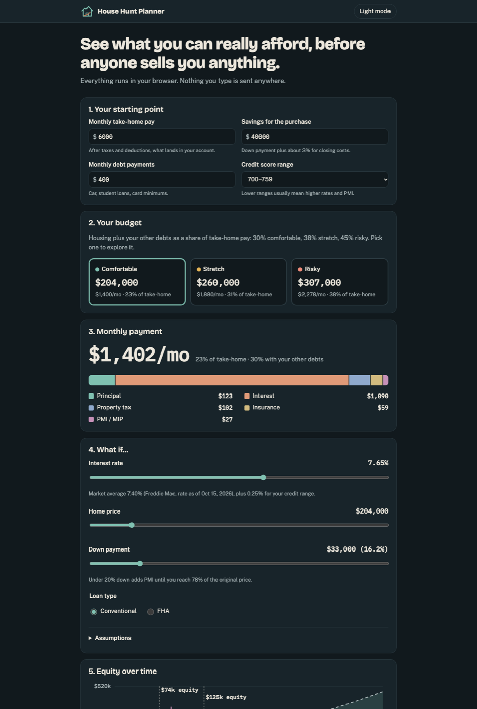

# House Hunt Planner

A free, private home-buying simulator: see what you can really afford before anyone sells you anything.

**Live site:** https://joshtseppich.github.io/house-hunt-planner/



Built for first-time buyers in Weber and Davis County, Utah. The defaults (tax rate, insurance) lean local, but the math works anywhere in the U.S.

## Features

- **Starting point:** take-home pay, savings, monthly debts and a credit score range.
- **Budget tiers:** comfortable, stretch and risky price points, each with its monthly cost and share of take-home pay.
- **Payment breakdown:** the full monthly number with a stacked bar for principal, interest, property tax, insurance and PMI/MIP.
- **What-if sliders:** rate, price and down payment update everything live. Conventional or FHA.
- **Equity timeline:** home value, loan balance and equity over 30 years, with 5- and 10-year markers and the month PMI drops off.
- **Area map:** Weber and Davis County with city and county outlines (MapLibre GL JS with OpenFreeMap tiles, no API key).
- **City property tax:** pick a city, or click it on the map, to use its published property tax rate. You can still type your own.
- Light and dark themes, mobile-first, keyboard accessible and respects reduced-motion settings.

## Privacy

There is no backend, no account, no analytics and no cookies. Everything is calculated in your browser. Your inputs are saved only in your browser's `localStorage` so they're there next time; clear site data to erase them. Third-party requests are limited to fonts from Google Fonts and, once you scroll to the map, the MapLibre library (unpkg) and map tiles (OpenFreeMap). None of them receive your numbers.

## Disclaimer

Estimates for education only. Not a loan offer or financial advice. Talk to a licensed lender before deciding.

The default interest rate is the Freddie Mac Primary Mortgage Market Survey 30-year average and is labelled with its date. It is not a live feed yet. Edit it to match a quote you've received.

This project does not rank or describe neighborhoods by schools, safety, demographics or "desirability," and never will.

## Run locally

It's a static site with no build step. Any static server works:

```bash
python3 -m http.server 8000
# then open http://localhost:8000
```

ES modules don't load over `file://`, so use a server rather than opening `index.html` directly.

## Run tests

Requires Node 20+. No dependencies.

```bash
npm test
# or: node --test tests/
```

The tests check the mortgage math in `js/mortgage.js` against published reference values and an independent closed-form amortization formula.

## Data sources

| Data | Source | License |
| --- | --- | --- |
| City and county boundaries (`data/boundaries.geojson`) | [Utah Geospatial Resource Center (UGRC)](https://gis.utah.gov/): Utah Municipal Boundaries and Utah County Boundaries | [CC BY 4.0](https://creativecommons.org/licenses/by/4.0/) |
| Base map tiles | [OpenFreeMap](https://openfreemap.org/), © [OpenMapTiles](https://www.openmaptiles.org/), data © [OpenStreetMap](https://www.openstreetmap.org/copyright) contributors | ODbL (data) |
| City property tax rates (`data/tax-rates.json`) | [Utah State Tax Commission, Report 600: Tax Rates by Tax Area](https://files.tax.utah.gov/propertytax/tax-rates/area-rates/taxarearates2025.pdf), 2025 final adopted rates | Public record |
| Default mortgage rate | [Freddie Mac PMMS](https://www.freddiemac.com/pmms) | Public |

The boundaries are simplified (about 22 m tolerance) for size, so treat them as approximate.

Each city spans several tax areas (different mixes of school, fire, water and other districts). The city default is the median final adopted total across those areas, times 55% because Utah taxes a primary residence on 55% of its value. The app shows the range too. Ogden Valley City has no city levy in the 2025 report, so it has no default.

To refresh the data:

```bash
npm run build:boundaries
npm run build:tax-rates   # needs pdftotext: brew install poppler
```

Update `YEAR` in `scripts/build-tax-rates.mjs` when the Tax Commission posts a new report (usually in January).

## Project layout

```
index.html          the page
css/styles.css      Sage and Sand theme
js/mortgage.js      pure mortgage math (no DOM)
js/app.js           UI wiring
js/map.js           lazy-loaded MapLibre area map
js/tax.js           pure property-tax helpers
data/               boundaries and tax-rate data (generated)
scripts/            data build scripts
tests/              node:test suite
docs/ROADMAP.md     phased plan
```

## Roadmap

See [docs/ROADMAP.md](docs/ROADMAP.md). In short:

1. Map of Weber and Davis County (MapLibre)
2. Guided "simulate buying" walkthrough
3. Live rate feed (FRED / Freddie Mac PMMS)
4. Scenario comparison and PDF export

## License

[MIT](LICENSE) © 2026 Joshua Seppich
